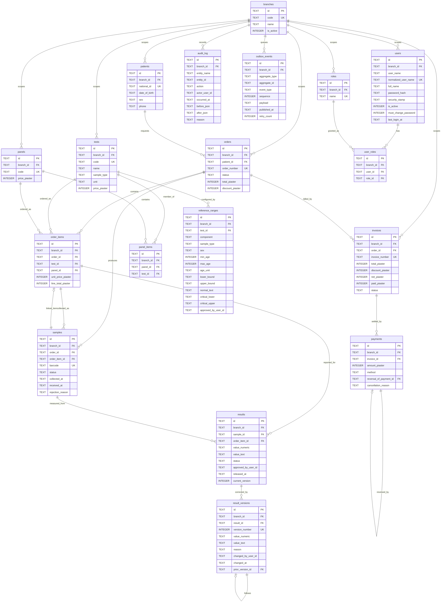

# EgyptLab LIS — Initial Entity Relationship Diagram

Status: Draft for owner review — Phase 0.3
Date: 2026-11-18
Implementation: `backend/src/EgyptLab.LIS.Infrastructure`
Migrations: `20261118083238_InitialSchema`, `20261118085228_AddAuthenticationFields`

This is the first database design. It implements the accepted stack in [ADR-0002](decisions/0002-stack.md) and the design conclusions in `docs/research/lis-notes.md`. It stores **structure only**: no test names, units, reference ranges, critical limits, prices, statuses, or patient data are seeded. Qualified laboratory staff must supply clinical values, and the owner must approve business policies, before any of them are used.

## Conventions applied to every table

| Rule | Implementation |
| --- | --- |
| Globally unique key | `id` is a client-generated UUID (`TEXT` in SQLite), never an auto-increment. |
| Branch scope | Every table has `branch_id`. On `branches` itself it equals `id`. A named query filter hides other branches after authentication; an unscoped query returns no rows. |
| Timestamps | `created_at` and `updated_at` are required UTC `DateTimeOffset`. |
| Soft delete | `deleted_at` is nullable; an EF global query filter excludes deleted rows on every table. |
| No hard delete | Every foreign key uses `ON DELETE RESTRICT`. |
| Money | All monetary columns end in `Piaster` and are `long` mapped to SQLite `INTEGER`. No floating-point money exists. |
| Sync readiness | `outbox_events` is created in the first migration, but no synchronization runs yet. |
| Append-only records | `audit_log`, `result_versions`, and `outbox_events` are not updated or deleted by design. |

## Diagram

`UK` marks a unique index. Composite unique indexes are used where a code is unique only inside a branch (for example `branch_id + code` for `tests`). The sample barcode is unique across all branches, so a scanner never finds two matches before synchronization.

## Deliberate design choices

1. **Order, Sample, Test and Result are separate entities.** This follows the research conclusion and supports panels, price snapshots, invoices, and specimen traceability.
2. **`result_versions` is a separate append-only table.** A correction inserts a new version with a mandatory `reason`, `changed_by_user_id`, and `changed_at`; earlier rows are never overwritten. `results.current_version` points at the latest one.
3. **Status columns are free text with no hard-coded values.** The vocabulary and allowed transitions are a business and clinical policy to be approved, not invented here.
4. **Reference ranges are configuration, not data.** `age_unit`, `sex`, and bound columns exist; no value is filled in. Missing context must later produce a recorded "range not applied" reason rather than a silent substitution.
5. **User identifiers on `results`, `reference_ranges`, `audit_log`, and `payments` remain logical references.** Authentication now exists, but these columns are only populated by later workflow services; adding foreign keys before those write paths exist would add no safety.
6. **Three extra tables were necessary.** `user_roles`, `panel_items`, and `outbox_events` are not named in the road map entity list, but the first two are required joins that must carry the same UUID and audit columns, and the third is explicitly required by ADR-0002 for sync readiness.
7. **Critical limits are columns only.** `critical_lower` and `critical_upper` store approved limits later; the system must never derive or guess them.

## Open questions for the owner

1. ~~Are roles branch-scoped, global, or both?~~ → Branch-scoped, approved in ADR-0003.
2. ~~Can one user hold several roles?~~ → Yes; effective permissions are the union, approved in ADR-0003.
3. What age unit should be the canonical stored form for reference ranges? The column allows an explicit unit, but no default is chosen.
4. Should a panel item inherit a single specimen type, or can a panel contain tests with different specimen types? This affects sample generation in Phase 2.
5. Are refunds represented only as reversing payments, or as a separate financial document? The schema currently models reversal only.
6. How should the first manager account be bootstrapped? No account or password is seeded in source control.

## Verification

`backend/tests/EgyptLab.LIS.Infrastructure.Tests/SchemaInvariantTests.cs` applies all real migrations to an empty SQLite database and asserts: every table has the six required base columns, named soft-delete and branch filters exist everywhere, all money columns are `long`/`INTEGER`, no floating-point money or seed data exists, all foreign keys restrict deletion, result versions require a reason, and sample barcodes are globally unique. `BranchIsolationTests.cs` proves that each branch sees only its own rows and that an unscoped query fails closed.
